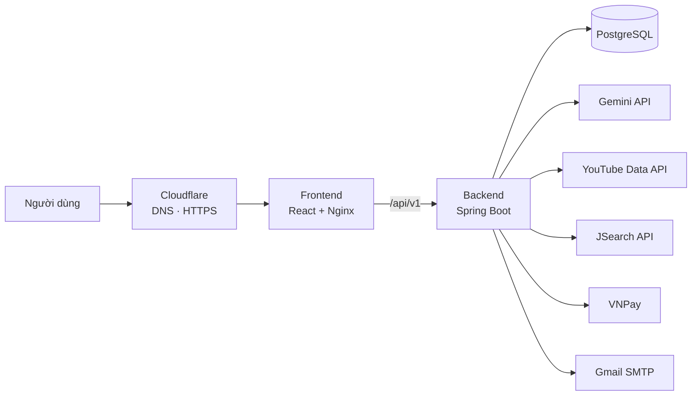

# AI Career Coach — Phân tích CV chuẩn ATS & gợi ý lộ trình kỹ năng

Hệ thống web giúp sinh viên tải CV lên, được AI chấm mức độ phù hợp với vị trí mục tiêu, chỉ ra kỹ năng còn thiếu và nhận lộ trình bổ sung kỹ năng kèm video học tập và tin tuyển dụng thật.

Demo: <https://devforge.io.vn>

<!--
Thêm ảnh chụp màn hình vào docs/screenshots/ rồi bỏ comment các dòng dưới:


-->

## Tính năng

**Người dùng**
- Đăng ký xác thực bằng OTP qua email, đăng nhập JWT, quên mật khẩu bằng OTP.
- Phân tích CV từ file PDF, ảnh (JPG/PNG), DOCX/TXT hoặc văn bản dán trực tiếp. PDF và ảnh được gửi thẳng cho Gemini đọc, nên CV thiết kế dạng ảnh cũng phân tích được.
- Báo cáo gồm điểm ATS, kỹ năng khớp và còn thiếu (kèm mức ưu tiên), lộ trình hành động với video YouTube, tin tuyển dụng thật (JSearch) và bản CV mẫu đã bổ sung kỹ năng (gói Plus).
- Lịch sử phân tích, biểu đồ tiến bộ theo thời gian, so sánh hai báo cáo, tải lại CV gốc.
- Cùng một CV và cùng vị trí thì mở lại kết quả cũ, không gọi AI và không trừ lượt.
- Nâng cấp gói Plus qua VNPay, nhận email khi hết lượt miễn phí và khi thanh toán thành công.

**Gói dịch vụ:** Free giới hạn số lượt phân tích (mặc định 3, đổi bằng `MAX_FREE_ANALYSES`). Plus không giới hạn và có thêm CV mẫu hoàn chỉnh.

**Quản trị** (`/admin`, yêu cầu `ROLE_ADMIN`)
- Tổng quan: chỉ số, biểu đồ theo ngày, phễu đăng ký đến nâng cấp, phân bố điểm ATS, danh sách việc cần chú ý.
- Người dùng (đổi gói, khoá/mở khoá), lượt phân tích (tải CV gốc), giao dịch. Có bộ lọc, tìm kiếm, phân trang và xuất CSV.

## Kiến trúc



Luồng phân tích CV:
1. Frontend gửi file hoặc văn bản kèm vị trí mục tiêu tới `POST /analysis/analyze`.
2. Backend kiểm tra giới hạn tốc độ và lượt dùng, đồng thời tra bộ nhớ đệm theo hash (CV + vị trí).
3. PDF/ảnh gửi thẳng cho Gemini; DOCX/TXT được trích văn bản trước. Gemini trả JSON có cấu trúc.
4. Backend bổ sung video YouTube và tin tuyển dụng, lưu kết quả (cột `jsonb`) rồi trả về cho frontend.

Gemini quá tải (429/5xx) thì tự thử lại với độ trễ tăng dần, sau đó chuyển sang model dự phòng. YouTube và JSearch lỗi hoặc chưa cấu hình thì rơi về liên kết tìm kiếm, không làm hỏng luồng phân tích.

## Công nghệ

| Tầng | Công nghệ |
|---|---|
| Frontend | React 19, TypeScript, Vite, TailwindCSS 4, React Router, Axios |
| Backend | Java 21, Spring Boot 3, Spring Security (JWT), Spring Data JPA / Hibernate, Maven |
| Cơ sở dữ liệu | PostgreSQL 16 (`jsonb`, `bytea`) |
| AI | Google Gemini API (đa phương thức, đầu ra JSON) |
| Tích hợp | YouTube Data API v3, JSearch (RapidAPI), VNPay (sandbox), Gmail SMTP |
| Hạ tầng | Docker, Docker Compose, Nginx, GitHub Actions, Cloudflare |

## Cấu trúc thư mục

```
.
├── backend/                  # Spring Boot API
│   ├── src/main/java/com/cvai/backend/
│   │   └── controller · service · repository · entity · dto · security · util
│   ├── src/test/             # JUnit 5
│   ├── Dockerfile
│   └── docker-compose.yml    # chạy local: backend + PostgreSQL
├── frontend/                 # React + Vite
│   ├── src/                  # pages · components (admin/) · contexts · api · utils
│   ├── Dockerfile
│   └── nginx.conf            # SPA fallback, proxy /api sang backend
├── docker-compose.yml        # production: postgres + backend + frontend
├── deploy.sh                 # git pull + docker compose up -d --build
├── .env.server.example       # mẫu biến môi trường cho server
└── .github/workflows/deploy.yml
```

## Chạy trên máy local

Yêu cầu: Docker, Node.js 20+.

```bash
git clone https://github.com/hieulefsdev-fs/ptich_CV_AI_DAU.git
cd ptich_CV_AI_DAU

# 1) Backend + PostgreSQL
cd backend
cp .env.example .env          # PowerShell: copy .env.example .env
# mở .env và điền các giá trị thật (xem bảng bên dưới)
docker compose up -d --build
docker compose ps             # đợi cvai_backend ở trạng thái (healthy)

# 2) Frontend
cd ../frontend
npm install
npm run dev                   # http://localhost:5173
```

Vite proxy `/api` sang `http://127.0.0.1:8080`. Kiểm tra backend: `GET http://localhost:8080/api/v1/actuator/health`.

**Tài khoản admin:** đăng ký tài khoản bằng đúng email đặt trong `ADMIN_BOOTSTRAP_EMAIL`, tài khoản đó sẽ có quyền `ROLE_ADMIN`.

## Biến môi trường

Chỉ liệt kê tên, **không commit file `.env`**. Mẫu nằm ở `backend/.env.example` và `.env.server.example`.

| Biến | Ý nghĩa |
|---|---|
| `DB_NAME`, `DB_USERNAME`, `DB_PASSWORD` | Kết nối PostgreSQL |
| `JWT_SECRET` | Khoá ký JWT, chuỗi ngẫu nhiên dài |
| `CORS_ALLOWED_ORIGINS` | Danh sách origin của frontend được phép gọi API |
| `FRONTEND_BASE_URL` | URL frontend (dùng trong link ở email) |
| `MAIL_USERNAME`, `MAIL_PASSWORD`, `MAIL_FROM` | Gmail SMTP (dùng App Password 16 ký tự) |
| `GEMINI_API_KEY`, `GEMINI_MODEL` | Khoá và model Gemini chính |
| `GEMINI_FALLBACK_MODELS` | Model dự phòng, cách nhau bằng dấu phẩy |
| `YOUTUBE_API_KEY` | Tuỳ chọn. Thiếu thì dùng liên kết tìm kiếm YouTube |
| `RAPIDAPI_KEY` | Tuỳ chọn. Thiếu thì dùng liên kết tìm việc |
| `VNPAY_TMN_CODE`, `VNPAY_HASH_SECRET`, `VNPAY_PAY_URL` | Cấu hình VNPay |
| `VNPAY_RETURN_URL` | Phải trỏ tới trang `/payment/vnpay-return` của **frontend** |
| `ADMIN_BOOTSTRAP_EMAIL` | Email được cấp quyền admin khi đăng ký |
| `MAX_FREE_ANALYSES` | Số lượt miễn phí của gói Free |
| `JPA_DDL_AUTO` | `update` hoặc `validate` (xem phần triển khai) |
| `FRONTEND_PORT` | Chỉ cho compose production: cổng frontend trên `127.0.0.1` |

Giới hạn tốc độ có thể chỉnh bằng `RATE_LIMIT_ENABLED`, `RATE_LIMIT_ANALYZE_PER_MINUTE`, `RATE_LIMIT_ANALYZE_PER_HOUR`.

## API chính

Tiền tố `/api/v1`.

| Nhóm | Endpoint |
|---|---|
| Xác thực | `POST /auth/register`, `/auth/verify-registration-otp`, `/auth/login`, `/auth/forgot-password`, `/auth/reset-password-otp`, `/auth/reset-password`; `GET /auth/me` |
| Phân tích | `POST /analysis/analyze` (multipart); `GET /analysis/history`; `GET`/`DELETE /analysis/{id}`; `GET /analysis/{id}/original-cv` |
| Thanh toán | `POST /payment/create-vnpay-url`; `GET /payment/vnpay-return` |
| Quản trị | `GET /admin/stats`, `/admin/users`, `/admin/analyses`, `/admin/orders`; `PUT /admin/users/{id}/toggle-active`, `/admin/users/{id}/change-tier` |
| Sức khoẻ | `GET /actuator/health` |

## Bảo mật

- Mật khẩu băm BCrypt, xác thực JWT không trạng thái, phân quyền theo role, CORS theo danh sách cho phép.
- Giới hạn tốc độ trong bộ nhớ: phân tích 5 lần/phút và 30 lần/giờ mỗi người dùng, đăng nhập 10 lần/phút/IP, gửi OTP 5 lần/10 phút/IP, đoán OTP 15 lần/10 phút/IP, tạo thanh toán 10 lần/phút. IP thật đọc từ `CF-Connecting-IP` khi chạy sau Cloudflare. Trả `429` kèm `Retry-After`.
- Xác thực chữ ký HMAC-SHA512 của VNPay trên mọi kết quả trả về.
- Khoá API và bí mật chỉ nằm trong biến môi trường. Khoá Gemini gửi qua header, không nằm trong URL, và được che trong log.
- Nội dung do người dùng nhập được escape trước khi đưa vào email. Dữ liệu xuất CSV chống chèn công thức.
- Khi triển khai, PostgreSQL và backend không mở cổng ra ngoài, chỉ frontend nghe trên `127.0.0.1`. Nên thêm lớp chặn theo IP cho `/admin` ở Cloudflare/WAF.
- Production dùng `JPA_DDL_AUTO=validate` để Hibernate không tự đổi cấu trúc dữ liệu.

## Triển khai

**CI/CD** (`.github/workflows/deploy.yml`): mỗi lần push lên `main` (hoặc chạy tay), workflow:
1. `build`: kiểm tra `docker-compose.yml` và build thử image backend, frontend.
2. `deploy`: SSH vào server chạy `deploy.sh` (`git pull`, `docker compose up -d --build`, dọn image cũ), rồi gọi thử domain.

Cần khai báo các secret trong repo GitHub: `SSH_HOST`, `SSH_PORT`, `SSH_USER`, `SSH_PRIVATE_KEY`.

> Push lên `main` sẽ tự deploy. Với thay đổi chỉ là tài liệu, thêm `[skip ci]` vào commit message để bỏ qua.

**Dựng trên server mới**
1. Clone repo lên server.
2. `cp .env.server.example .env`, điền giá trị (bắt buộc: `DB_PASSWORD`, `JWT_SECRET`, `FRONTEND_PORT`), rồi `chmod 600 .env`.
3. `docker compose up -d --build` (hoặc `./deploy.sh`).
4. Cấu hình reverse proxy hoặc tunnel trỏ tên miền tới `127.0.0.1:<FRONTEND_PORT>`.
5. Lần chạy đầu để `JPA_DDL_AUTO=update` cho Hibernate tạo bảng, sau đó đổi sang `validate`. Khi thay đổi code có thêm hoặc sửa cột, đổi tạm về `update`, deploy, rồi đổi lại `validate`.

## Kiểm thử

Các lớp logic thuần (giới hạn tốc độ, bộ nhớ đệm, chuẩn hoá tên vị trí, hash, chuỗi model dự phòng, escape HTML) có unit test bằng JUnit 5:

```bash
cd backend
mvn test
# hoặc không cần cài Maven:
docker run --rm -v "$(pwd):/app" -w /app maven:3.9-eclipse-temurin-21 mvn -B test
```

PowerShell dùng `${PWD}` thay cho `$(pwd)`.

## Hạn chế đã biết

- VNPay đang chạy ở môi trường sandbox. Chuyển sang môi trường thật cần đăng ký merchant với tư cách hộ kinh doanh hoặc doanh nghiệp.
- Điểm ATS do mô hình ngôn ngữ chấm, chưa được đối chiếu với đánh giá của chuyên gia tuyển dụng.
- Chưa có test tích hợp, và CI chưa chạy các unit test nói trên.
- Xác nhận thanh toán hiện dựa vào việc khách quay về trang kết quả của frontend. Nếu đóng trang sớm, đơn có thể treo ở trạng thái `PENDING`; cần bổ sung kênh VNPay báo thẳng về server (IPN).
- Giới hạn tốc độ lưu trong bộ nhớ của một instance, đủ cho mô hình một container.

 GitHub: [@hieulefsdev-fs](https://github.com/hieulefsdev-fs).

Dự án học tập, chưa gắn giấy phép mã nguồn mở.
